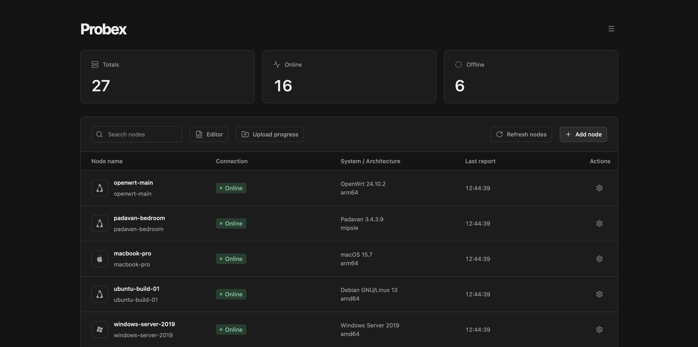
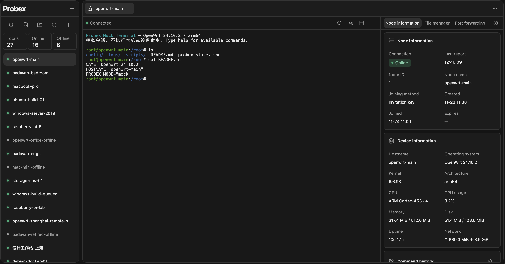
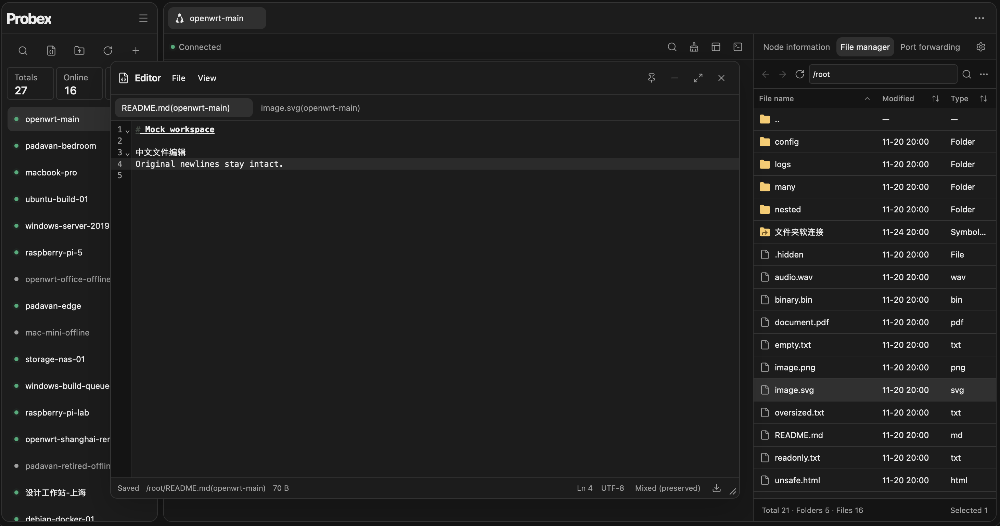
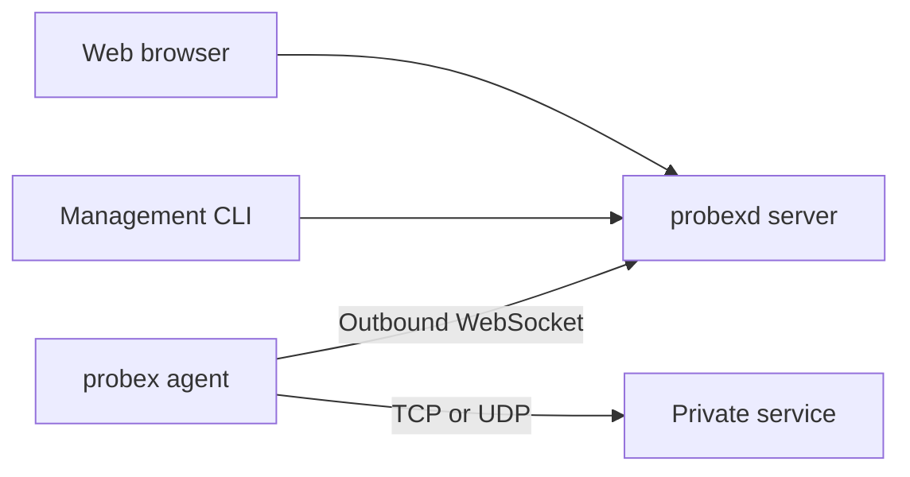

# Probex · Simple, efficient host management

English | [简体中文](README.zh-CN.md)

Manage devices wherever they are, as long as they can reach the Probex server. Without SSH, you can view device metrics, open a terminal, run commands, manage and edit files, and forward TCP or UDP traffic to private services. Probex is designed for remote operations and for reaching services behind NAT.

## Features

- **Authenticated access.** The Web UI and management CLI use an admin token. Each remote agent has its own identity. HTTPS and WSS protect traffic in transit when TLS is enabled. Keep the admin token and agent state files private.
- **Outbound agent connection.** Run a lightweight agent on each remote device. The device needs a route to the server and requires no inbound management port or SSH service.
- **File management and editing.** Browse, upload, and download files, preview media and PDFs, and edit text in a multi-tab editor. Files that cannot be previewed open in an editor tab with a download button.
- **Interactive terminals and one-off commands.** Open persistent, split terminals with Unix shells or PowerShell on Windows. Run one-off commands from the CLI and view their output and exit status in the Web UI.
- **TCP and UDP forwarding.** Listen on the server and forward traffic to a service on the agent host or to a private address the agent can reach.
- **Web and CLI management.** Use the browser for daily operations and the CLI for node management, commands, file transfers, and forwarding.

## Quick start

This guide covers **v0.2.1**. Use matching server and client binaries. [Build from source](#build) or check [GitHub Releases](https://github.com/geekip/probex/releases) for published binaries.

| Program   | Role                                                               | Build targets                                                         |
| --------- | ------------------------------------------------------------------ | --------------------------------------------------------------------- |
| `probexd` | Server with an embedded Web UI, SQLite storage, and management CLI | Linux amd64                                                           |
| `probex`  | Agent running on the managed device                                | Linux amd64, arm64, and mipsle soft-float, macOS arm64, Windows amd64 |

### Server

Mark the Linux amd64 binary executable and start the server.

```sh
chmod +x ./probexd-linux-amd64
./probexd-linux-amd64
```

Open <http://127.0.0.1:17892> on the server. By default, the server creates `probex.db` and `probexd.token` beside the executable. The startup log shows the token file path. Use its contents to sign in. The built-in **Probexd-Local** node (ID `0`) is ready to use as soon as the server starts. Its terminal and file operations run with the server process account's permissions. To disable this node, start with `--enable-agent=false`.

For remote access, use a DNS name that resolves to the server and enable HTTPS/WSS. To use a private CA, stop the local test instance first, then generate a certificate and restart the server with TLS. Replace `probex.example.com` with the actual server name.

```sh
./probexd-linux-amd64 create-tls --hosts probex.example.com
./probexd-linux-amd64 --listen 0.0.0.0:17892 \
  --tls-cert ./probexd.cert --tls-key ./probexd.key \
  --allow-registration=false
```

Trust the generated `probex.crt` in the browser, then open `https://probex.example.com:17892`. You can also pass an existing certificate chain and private key. The example accepts agents with an invitation key. To allow devices to request enrollment while requiring manual approval, use `--allow-registration=true --auto-approve=false`.

#### Server options

These options apply to both `probexd` and `probexd listen`. The `listen` subcommand also accepts the address as its first positional argument.

| Option                      | Default                                                        | Description                                                                                                                        |
| --------------------------- | -------------------------------------------------------------- | ---------------------------------------------------------------------------------------------------------------------------------- |
| `--listen HOST:PORT`        | `127.0.0.1:17892`                                              | Address for Web management, the API, and agent connections.                                                                        |
| `--db PATH`                 | `probex.db` beside the executable                              | SQLite database path.                                                                                                              |
| `--admin-token TOKEN`       | `PROBEX_ADMIN_TOKEN`, or `probexd.token` beside the executable | Set the token for Web and CLI management directly.                                                                                 |
| `--admin-token-file PATH`   | Unset                                                          | Read the token from an existing file accessible only to its owner. Takes precedence over `--admin-token` and `PROBEX_ADMIN_TOKEN`. |
| `--tls-cert PATH`           | Unset                                                          | TLS certificate chain in PEM format. Supply it together with `--tls-key` to enable HTTPS/WSS.                                      |
| `--tls-key PATH`            | Unset                                                          | PEM private key matching the TLS certificate.                                                                                      |
| `--allow-registration BOOL` | `true`                                                         | Allow agents to request enrollment. Agents with an invitation key can still join when this is `false`.                             |
| `--auto-approve BOOL`       | `true`                                                         | Automatically approve new enrollment requests. Set to `false` for manual approval.                                                 |
| `--join-ttl DURATION`       | `24h`                                                          | Validity period for new invitation keys, such as `2h`.                                                                             |
| `--enable-agent BOOL`       | `true`                                                         | Enable the built-in `Probexd-Local` node.                                                                                          |

#### Certificate generation options

`probexd create-tls` accepts the following options. Default output files are written beside the executable.

| Option            | Default                   | Description                                                              |
| ----------------- | ------------------------- | ------------------------------------------------------------------------ |
| `--hosts LIST`    | `localhost,127.0.0.1,::1` | Comma-separated DNS names or IP addresses to include in the certificate. |
| `--tls-cert PATH` | `probexd.cert`            | Output path for the server certificate chain.                            |
| `--tls-key PATH`  | `probexd.key`             | Output path for the server private key.                                  |
| `--ca PATH`       | `probex.crt`              | Output path for the public CA certificate.                               |

### Client

In the Web UI, select **Add node**, name the node `node1`, and copy its join key. On the device, select the binary for its platform and pass it the join key. The commands below use the Linux arm64 binary.

```sh
chmod +x ./probex-linux-arm64
./probex-linux-arm64 connect \
  --server wss://probex.example.com:17892 \
  --key 'px1_REPLACE_WITH_JOIN_KEY' \
  --state ./probex-state.json
```

On Windows, run `probex-windows-amd64.exe` with the same arguments. If both programs run on the same host with the default server settings, use `ws://127.0.0.1:17892`.

The join key is single-use and expires after 24 hours by default. After the first connection, keep the state file and omit `--key` on subsequent starts. Use `--key-file` to read the key from a private file. When `probexd` serves TLS directly, the join key carries the public certificate data. Use `--ca` to specify a private CA explicitly when needed.

#### Client options

| Option            | Default                                                                       | Description                                                                                                                                                 |
| ----------------- | ----------------------------------------------------------------------------- | ----------------------------------------------------------------------------------------------------------------------------------------------------------- |
| `--server URL`    | Required                                                                      | Server URL using `ws://` or `wss://`, with default ports 80 and 443 respectively. HTTP and HTTPS URLs are converted to the corresponding WebSocket schemes. |
| `--key KEY`       | Unset                                                                         | Single-use invitation key. Use either `--key` or `--key-file`.                                                                                              |
| `--key-file PATH` | Unset                                                                         | Read the invitation key from a file.                                                                                                                        |
| `--name NAME`     | From the invitation key or saved identity                                     | Supply a node name to request enrollment without an invitation key. If used with a key, the name must match the name in the key.                            |
| `--state PATH`    | `probex-state.json` in the current directory                                  | File used to store and reuse the agent identity.                                                                                                            |
| `--ca PATH`       | Certificate data from the invitation key or saved identity, then system trust | Use a PEM CA certificate for TLS verification. An explicit file overrides saved or invitation certificate data.                                             |
| `--rejoin`        | `false`                                                                       | Generate a new identity and replace the existing state when enrolling again.                                                                                |

### Web management

**Node overview.** Check connection status, operating system, architecture, and last report time. Search for a node or add a new one.



**Terminal workspace.** Select an online node to open a terminal. Open split panes as needed, and check device metrics and command history in the side panel.



**File manager and editor.** Browse the node's files in the side panel, then double-click a file to preview or edit it. The file manager also provides upload and download actions.



## FAQ

### Do agents need a public IP or an open port?

Each agent initiates an outbound connection to `probexd`. Make the server's address reachable from the managed devices. The default loopback listener is for local use. When using a reverse proxy, enable WebSocket upgrades and allow streaming uploads and downloads. Use the final WebSocket URL in `--server`.

### How do I use the management CLI?

Run these commands on the server host, using the same binary and the default local token file. These examples assume that `node1` is online and has the specified file.

```sh
./probexd-linux-amd64 list
./probexd-linux-amd64 exec --client node1 --command 'hostname'
./probexd-linux-amd64 cp 'node1:/var/log/app.log' ./app.log
```

Use `cp -r` for directories. For remote CLI access, supply `--server https://probex.example.com:17892` and `--admin-token-file`. Use `--ca` when the service uses a private CA.

### Where does forwarded traffic enter?

In a forwarding rule, the **server listen address** is where users connect. The **client target address** is where the agent connects. The rule below makes a LAN web service available on the server's loopback address at port 8080.

```sh
./probexd-linux-amd64 forward 127.0.0.1:8080 node1:192.168.1.10:80
```

Use `--protocol udp` for UDP. The Web UI also supports TCP + UDP on the same address. Forwarded ports have their own listeners and accept connections independently of the Web login. Use loopback when only the server host needs access.

### Which shells and file types are supported?

Interactive sessions prefer Zsh, then Bash, then `/bin/sh` on macOS. Linux prefers Bash, then `/bin/sh`. Windows prefers PowerShell 7, then Windows PowerShell, then CMD. One-off commands use `/bin/sh -c` on Unix and CMD on Windows.

The editor supports UTF-8 and GBK. Text up to 2 MiB can be edited. Text above 2 MiB and up to 10 MiB opens read-only. Larger text and unsupported files offer a download. Image, audio, and video previews depend on browser support. PDF preview is built in.

### What happens during a network outage or upgrade?

Agents reconnect after temporary network interruptions. Interrupted terminal sessions and forwarded connections need to be opened again. A one-off command with an unknown result is never automatically rerun.

Back up `probex.db` before upgrading, and keep client and server versions aligned. Preserve each client's state file so it can reconnect using its existing identity.

## Developers

### Architecture



The agent reports host information over a persistent WebSocket control connection. The server manages enrollment, authenticates operators, and stores node metadata, command history, and forwarding rules in SQLite. Terminal, file, and forwarding traffic travels through a multiplexed WebSocket tunnel. The agent starts the system shell through PTY on Unix or ConPTY on Windows. Commands and file operations run with the agent account's permissions.

The server and agent are written in Go. The Web UI uses Svelte, TypeScript, xterm.js, and CodeMirror. The production assets are embedded in `probexd`, so the deployed server can serve the Web UI from a single executable.

### Development

Install frontend dependencies and start the mock workspace to develop without a live backend.

```sh
npm --prefix web ci
npm --prefix web run dev:mock
```

Open the address printed by Vite and sign in with `mock`. For real-backend development, run `npm --prefix web run dev` and start a built `probexd` on `127.0.0.1:17891`, the development proxy target. [Web source layout](web/README.md) · [Mock scenarios](web/mock/README.md)

### Build

Build on Linux with Bash, Go 1.26.11, and Node.js 24.21.0, the toolchain versions used by the release workflow.

```sh
npm --prefix web ci
bash scripts/build.sh
go test ./...
```

The script checks frontend formatting and types, builds `web/dist/`, embeds the assets in the server, and writes the server and five client binaries to `dist/` with `SHA256SUMS`. Once `web/dist/` exists, run `bash scripts/build-go.sh` to rebuild the binaries with the existing Web assets. [Third-party notices](THIRD_PARTY_NOTICES)
