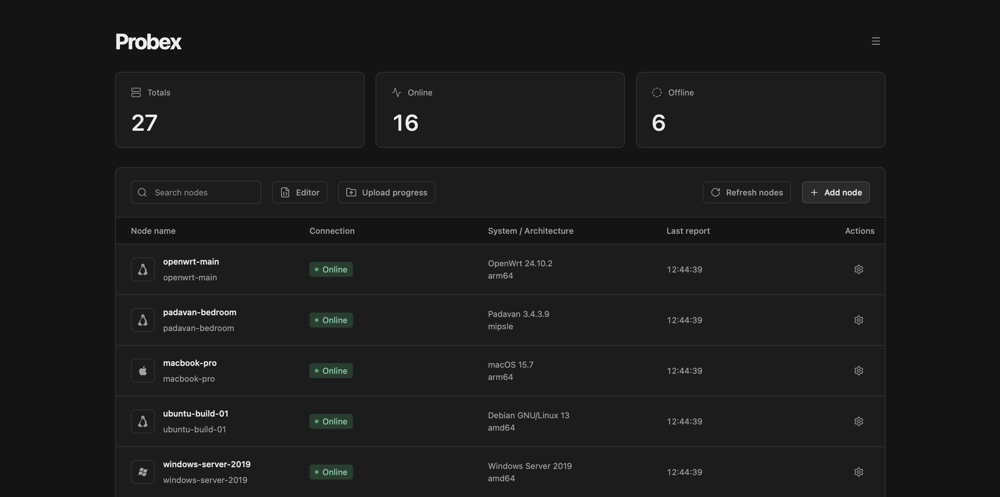
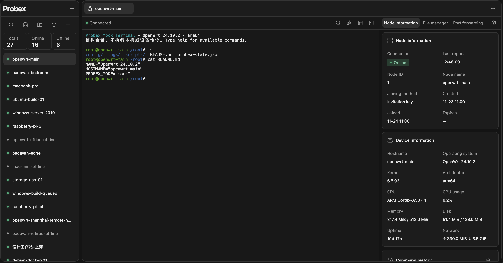
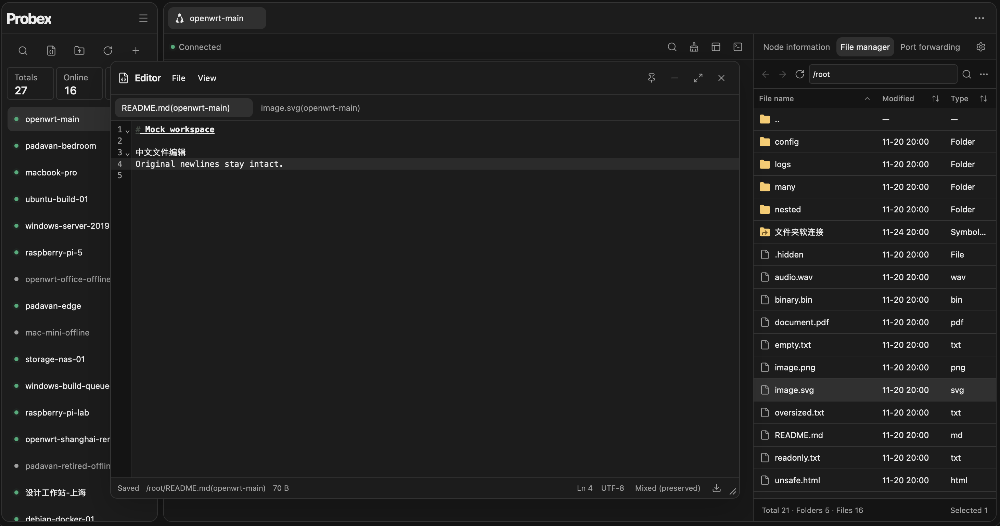
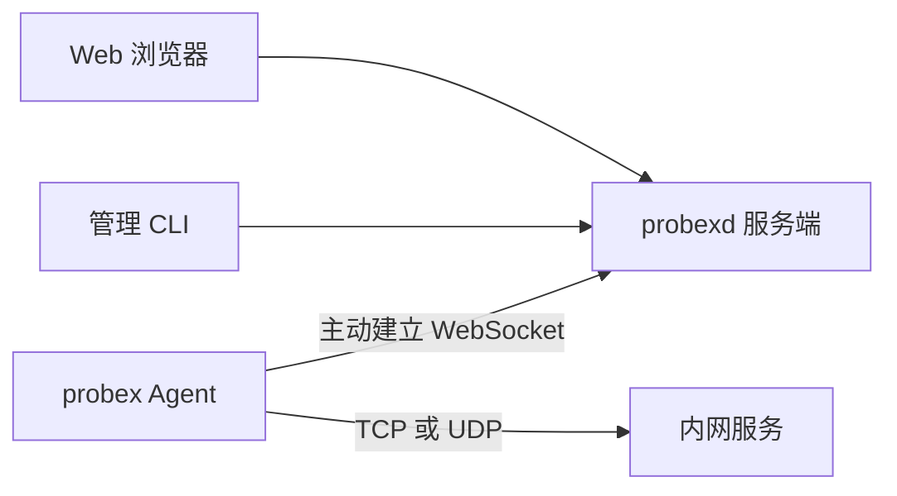

# Probex 简单高效的主机管理工具

[English](README.md) | 简体中文

无论设备身在何处，只要能连接 Probex 服务端，就能在无需 SSH 的情况下查看设备信息、打开终端、执行命令、管理和在线编辑文件，以及转发 TCP 或 UDP 流量。适用于远程运维、内网端口穿透和访问内网服务。

## 特性

- **认证与加密。** Web 管理端和管理 CLI 使用管理令牌，各远程 Agent 使用独立身份。启用 TLS 后，HTTPS 和 WSS 可加密传输。请妥善保管管理令牌和 Agent 身份文件。
- **Agent 主动连接。** 在远程设备运行轻量 Agent。设备只需能访问服务端，无需开放入站管理端口或运行 SSH 服务。
- **文件管理与在线编辑。** 浏览、上传和下载文件，预览媒体与 PDF，在多标签编辑器中编辑文本。无法预览的文件也可在编辑器标签中直接下载。
- **远程终端与命令。** 支持 Unix Shell 和 Windows PowerShell，可在浏览器中打开持续会话和分屏。通过 CLI 执行单次命令，在 Web 中查看输出和退出码。
- **TCP/UDP 转发。** 在服务端监听端口，将流量转发到 Agent 本机或 Agent 可访问的内网服务。
- **Web 与 CLI 管理。** 日常运维可使用浏览器，也可通过 CLI 管理节点、执行命令、传输文件和配置转发。

## 快速开始

本文适用于 **v0.2.0**。请使用同一版本的服务端和客户端。可[从源码编译](#编译)，也可在 [GitHub Releases](https://github.com/geekip/probex/releases) 查看已发布的二进制文件。

| 程序      | 用途                                             | 编译目标                                                      |
| --------- | ------------------------------------------------ | ------------------------------------------------------------- |
| `probexd` | 服务端，内置 Web 管理界面、SQLite 存储和管理 CLI | Linux amd64                                                   |
| `probex`  | 运行在被管理设备上的 Agent                       | Linux amd64、arm64、mipsle 软浮点，macOS arm64，Windows amd64 |

### 服务端

在 Linux amd64 主机上给二进制文件添加执行权限，然后启动服务端。

```sh
chmod +x ./probexd-linux-amd64
./probexd-linux-amd64
```

在服务端主机上打开 <http://127.0.0.1:17892>。默认在程序所在目录创建 `probex.db` 和 `probexd.token`。启动日志会打印令牌文件的位置，用文件内容登录。内置节点 **Probexd-Local**（ID 为 `0`）随服务端启动，可直接打开终端和管理文件，操作权限与服务端进程账户一致。启动时可用 `--enable-agent=false` 禁用内置节点。

远程访问时，使用能解析到服务端的域名并启用 HTTPS/WSS。使用私有 CA 时，先停止本地测试实例，再生成证书并以 TLS 启动服务端。将 `probex.example.com` 替换为实际域名。

```sh
./probexd-linux-amd64 create-tls --hosts probex.example.com
./probexd-linux-amd64 --listen 0.0.0.0:17892 \
  --tls-cert ./probexd.cert --tls-key ./probexd.key \
  --allow-registration=false
```

在浏览器信任生成的 `probex.crt` 后，打开 `https://probex.example.com:17892`。也可以使用已有的证书链和私钥。此示例允许持加入密钥的 Agent 接入。如需允许设备主动申请并由管理员审核，使用 `--allow-registration=true --auto-approve=false`。

#### 服务端启动参数

以下参数适用于 `probexd` 和 `probexd listen`。使用 `listen` 子命令时，也可将监听地址写为第一个位置参数。

| 参数                        | 默认值                                                     | 说明                                                                                   |
| --------------------------- | ---------------------------------------------------------- | -------------------------------------------------------------------------------------- |
| `--listen HOST:PORT`        | `127.0.0.1:17892`                                          | Web 管理端、API 和 Agent 连接共用的监听地址。                                          |
| `--db PATH`                 | 程序目录下的 `probex.db`                                   | SQLite 数据库路径。                                                                    |
| `--admin-token TOKEN`       | `PROBEX_ADMIN_TOKEN`，否则使用程序目录下的 `probexd.token` | 直接指定 Web 和 CLI 使用的管理令牌。                                                   |
| `--admin-token-file PATH`   | 未设置                                                     | 从仅文件属主可访问的已有文件读取令牌，优先于 `--admin-token` 和 `PROBEX_ADMIN_TOKEN`。 |
| `--tls-cert PATH`           | 未设置                                                     | PEM 格式的 TLS 证书链。与 `--tls-key` 一起提供即可启用 HTTPS/WSS。                     |
| `--tls-key PATH`            | 未设置                                                     | 与 TLS 证书匹配的 PEM 格式私钥。                                                       |
| `--allow-registration BOOL` | `true`                                                     | 允许 Agent 主动申请加入。设为 `false` 时，持加入密钥的 Agent 仍可接入。                |
| `--auto-approve BOOL`       | `true`                                                     | 自动批准新的加入申请。设为 `false` 时改为人工审核。                                    |
| `--join-ttl DURATION`       | `24h`                                                      | 新签发的加入密钥有效期，例如 `2h`。                                                    |
| `--enable-agent BOOL`       | `true`                                                     | 启用内置节点 `Probexd-Local`。                                                         |

#### 证书生成参数

`probexd create-tls` 支持以下参数。默认将输出文件写到程序目录。

| 参数              | 默认值                    | 说明                                         |
| ----------------- | ------------------------- | -------------------------------------------- |
| `--hosts LIST`    | `localhost,127.0.0.1,::1` | 写入证书的域名或 IP 地址，多个值用逗号分隔。 |
| `--tls-cert PATH` | `probexd.cert`            | 服务端证书链的输出路径。                     |
| `--tls-key PATH`  | `probexd.key`             | 服务端私钥的输出路径。                       |
| `--ca PATH`       | `probex.crt`              | 公开 CA 证书的输出路径。                     |

### 客户端

在 Web 管理端点击 **添加节点**，节点名称填 `node1`，复制生成的加入密钥。在设备上选择对应平台的客户端并传入加入密钥。下面的命令使用 Linux arm64 客户端。

```sh
chmod +x ./probex-linux-arm64
./probex-linux-arm64 connect \
  --server wss://probex.example.com:17892 \
  --key 'px1_REPLACE_WITH_JOIN_KEY' \
  --state ./probex-state.json
```

Windows 上使用 `probex-windows-amd64.exe`，参数相同。若在同一台设备运行服务端和客户端，并使用服务端默认设置，连接地址填 `ws://127.0.0.1:17892`。

加入密钥只可使用一次，默认 24 小时有效。首次连接后保留身份文件，后续启动可省略 `--key`。也可用 `--key-file` 从私有文件读取加入密钥。由 `probexd` 直接提供 TLS 时，加入密钥包含公开证书数据。如需显式指定私有 CA，使用 `--ca`。

#### 客户端连接参数

| 参数              | 默认值                                                   | 说明                                                                                                                                |
| ----------------- | -------------------------------------------------------- | ----------------------------------------------------------------------------------------------------------------------------------- |
| `--server URL`    | 必填                                                     | 使用 `ws://` 或 `wss://` 的服务端地址，默认端口分别为 80 和 443。也可使用 HTTP 或 HTTPS 地址，客户端会转换为对应的 WebSocket 协议。 |
| `--key KEY`       | 未设置                                                   | 一次性加入密钥，与 `--key-file` 二选一。                                                                                            |
| `--key-file PATH` | 未设置                                                   | 从文件读取加入密钥。                                                                                                                |
| `--name NAME`     | 使用加入密钥或已保存身份中的名称                         | 无加入密钥时，指定节点名称发起加入申请。与加入密钥一起使用时，名称须一致。                                                          |
| `--state PATH`    | 当前目录下的 `probex-state.json`                         | 保存和复用 Agent 身份的文件。                                                                                                       |
| `--ca PATH`       | 使用加入密钥或已保存身份中的证书数据，否则使用系统信任库 | 指定 TLS 校验使用的 PEM 格式 CA 证书。显式指定时优先于加入密钥或已保存身份中的证书数据。                                            |
| `--rejoin`        | `false`                                                  | 重新加入时生成新身份，并替换原有身份文件。                                                                                          |

### Web 管理端

**节点总览。** 查看节点连接状态、系统、架构和最后上报时间，支持搜索和添加节点。



**终端工作区。** 选择在线节点即可打开交互终端，按需分屏，在右侧查看设备信息和命令记录。



**文件管理与编辑器。** 在右侧浏览节点文件，双击打开预览或编辑。文件管理器也提供上传和下载操作。



## 常见问题

### 客户端需要公网 IP 或开放端口吗？

Agent 主动向 `probexd` 建立连接，被管理设备只需能访问服务端。服务端默认监听回环地址，适用于本机体验。使用反向代理时，需支持 WebSocket 升级以及流式上传和下载，客户端的 `--server` 填最终可连接的 WebSocket 地址。

### 怎么通过 CLI 管理？

以下示例在服务端主机执行，使用同一个二进制及本机默认令牌文件。示例假定 `node1` 在线并有指定文件。

```sh
./probexd-linux-amd64 list
./probexd-linux-amd64 exec --client node1 --command 'hostname'
./probexd-linux-amd64 cp 'node1:/var/log/app.log' ./app.log
```

目录使用 `cp -r`。远程管理时传入 `--server https://probex.example.com:17892` 和 `--admin-token-file`。服务器使用私有 CA 时可用 `--ca` 指定。

### 转发端口开在哪里？

**服务端监听地址**供访问者连接，**客户端目标地址**由 Agent 发起连接。下面的规则将内网 Web 服务转发到服务端回环地址的 8080 端口。

```sh
./probexd-linux-amd64 forward 127.0.0.1:8080 node1:192.168.1.10:80
```

UDP 使用 `--protocol udp`，Web 管理端也支持在同一地址配置 TCP + UDP。转发端口独立监听，访问者可直接连接，无需 Web 登录。仅供服务端本机使用时，监听回环地址即可。

### 支持哪些 Shell 和文件类型？

交互终端在 macOS 依次尝试 Zsh、Bash、`/bin/sh`，Linux 优先 Bash，其次 `/bin/sh`。Windows 依次尝试 PowerShell 7、Windows PowerShell、CMD。单次命令在 Unix 使用 `/bin/sh -c`，在 Windows 使用 CMD。

编辑器支持 UTF-8 和 GBK。2 MiB 以内的文本可编辑，超过 2 MiB 至 10 MiB 的文本只读，更大的文本及不支持预览的文件提供下载。图片、音频和视频的预览取决于浏览器，PDF 由内置预览器打开。

### 断网和升级会怎样？

短时断网后，Agent 会自动重连。已经中断的终端和转发连接需要重新打开。结果未知的单次命令不会自动重跑。

升级前备份 `probex.db`，将客户端和服务端一同升级。保留客户端的身份文件，以便重连时继续使用已有身份。

## 开发者

### 技术原理



Agent 通过持久 WebSocket 控制连接上报设备信息。服务端负责节点准入和管理员认证，使用 SQLite 保存节点信息、命令记录和转发规则。终端、文件和转发数据通过多路复用的 WebSocket 隧道传输。Agent 在 Unix 上通过 PTY、在 Windows 上通过 ConPTY 启动系统终端。命令和文件操作使用 Agent 账户的权限。

服务端和 Agent 使用 Go，Web 使用 Svelte、TypeScript、xterm.js 和 CodeMirror。生产前端资源嵌入 `probexd`，一个服务端可执行文件即可提供 Web 管理界面。

### 开发

安装前端依赖并启动 Mock 工作区，即可独立开发前端。

```sh
npm --prefix web ci
npm --prefix web run dev:mock
```

打开 Vite 输出的地址，使用 `mock` 登录。联调真实后端时，运行 `npm --prefix web run dev`，并让已编译的 `probexd` 监听开发代理的目标地址 `127.0.0.1:17891`。[Web 源码结构](web/README.md) · [Mock 场景](web/mock/README.md)

### 编译

在 Linux 上使用 Bash、Go 1.26.11 和 Node.js 24.21.0，与发布工作流的版本一致。

```sh
npm --prefix web ci
bash scripts/build.sh
go test ./...
```

脚本检查前端格式及类型，构建 `web/dist/` 并嵌入服务端，在 `dist/` 输出服务端、五个平台的客户端和 `SHA256SUMS`。若 `web/dist/` 已存在，可运行 `bash scripts/build-go.sh`，使用现有 Web 产物重新编译二进制文件。[第三方许可声明](THIRD_PARTY_NOTICES)
